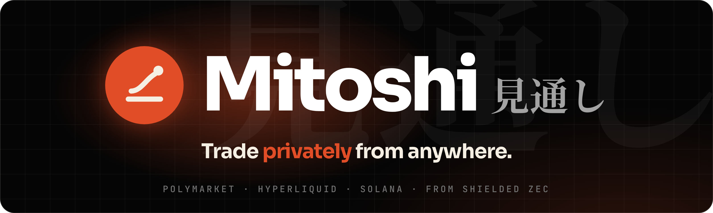
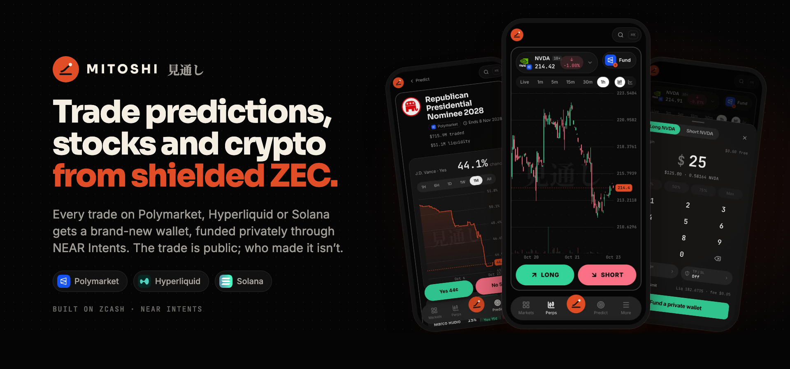
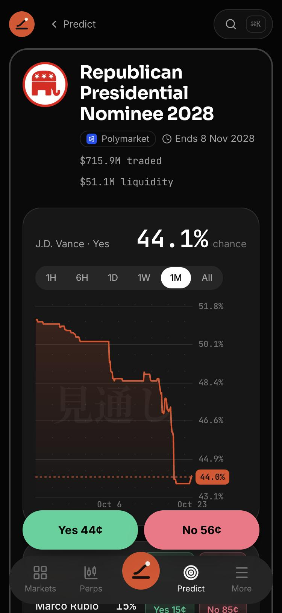
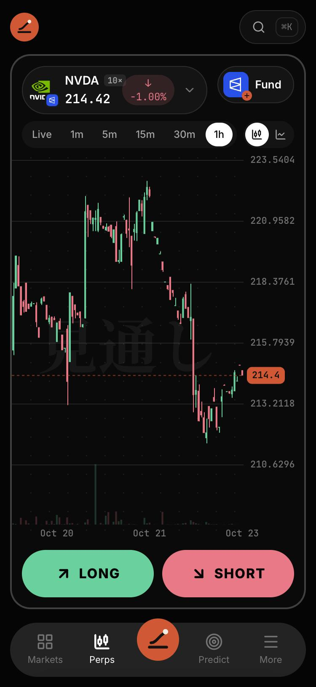
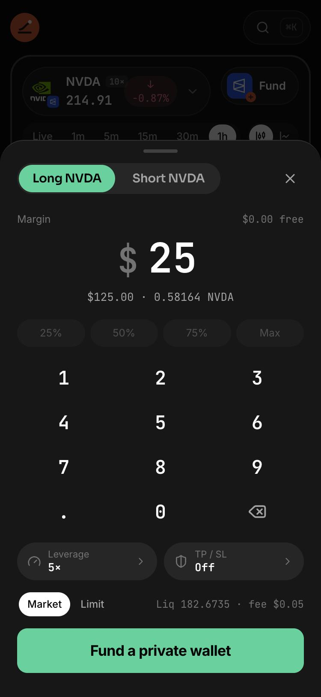
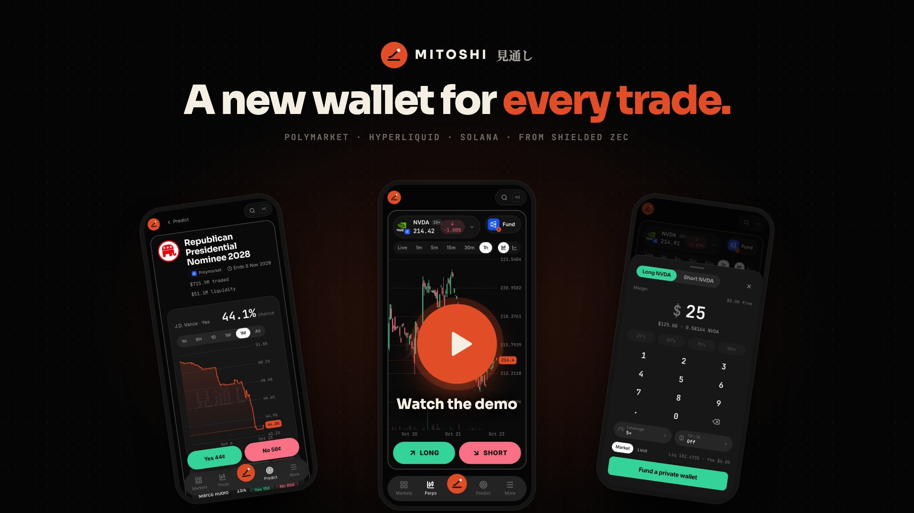
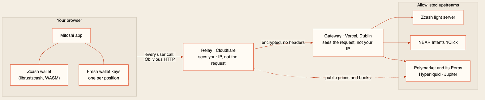
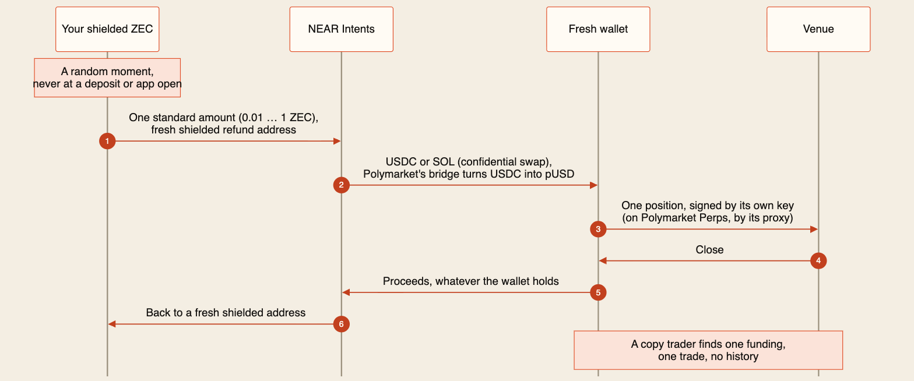

<p align="center">
  <a href="https://mitoshi.xyz">
    
  </a>
</p>

<p align="center"><b>A new wallet for every trade.</b><br/>Trade Polymarket, Hyperliquid and Solana privately, from shielded ZEC.</p>

<p align="center">
  <a href="https://mitoshi.xyz"><b>Open Mitoshi</b></a>
  &nbsp;·&nbsp;
  <a href="https://mitoshi.xyz/demo"><b>Demo</b></a>
  &nbsp;·&nbsp;
  <a href="https://youtu.be/Ll-X6zQsO6Q"><b>YouTube</b></a>
  &nbsp;·&nbsp;
  <a href="https://mitoshi.xyz/pitch"><b>Pitch</b></a>
  &nbsp;·&nbsp;
  <a href="https://docs.mitoshi.xyz"><b>Docs</b></a>
  &nbsp;·&nbsp;
  <a href="#who-sees-what"><b>Who sees what</b></a>
  &nbsp;·&nbsp;
  <a href="#proof-and-evidence"><b>Proof</b></a>
  &nbsp;·&nbsp;
  <a href="https://mitoshi.xyz/status"><b>Status</b></a>
</p>

<p align="center">
  <a href="https://mitoshi.xyz">
    <picture></picture>
  </a>
</p>

Predictions, stocks and crypto from one shielded balance: every trade gets a brand-new wallet, funded through NEAR
Intents, with no history to follow. From one shielded ZEC balance you bet on prediction markets, trade US stocks,
indices, gold and oil, go long or short on crypto perps, and buy Solana tokens, with one portfolio across all of them.
The privacy is the engine: a real Zcash wallet runs in your browser, every funding is one standard amount sent at a
random moment, every call about your wallets travels over Oblivious HTTP, and Send home swaps the money back to a fresh
shielded address.

Built for **[ZECATHON](https://thezecathon.com) · Private Markets** ([how Mitoshi meets the hackathon](#how-mitoshi-meets-the-hackathon)).
*Mitoshi* (見通し) means **outlook**: the view ahead.

> **Judges: try it in 30 seconds.** The **Working demo** link in our submission opens judge.mitoshi.xyz with a shared
> wallet that already holds real money on Hyperliquid, funded from shielded ZEC. Press **Trade BTC now** and go long or
> short ($2.50 at 5× clears Hyperliquid's $10 minimum). Then the **Judge** button at the top walks you through what the
> public sees and the funding on the Zcash explorer. No link to hand? [Look around](https://mitoshi.xyz/markets).

## The problem

On Polymarket, Hyperliquid and other onchain markets, every trade is public. Each wallet's positions, wins and losses
can be read by anyone, and tools rank those wallets so others can copy the best ones: one graded 7,756 Polymarket
wallets for copy trading ([r/Polymarket](https://www.reddit.com/r/Polymarket/comments/1vu93xl/), 2026-08-21). "The copy
traders literally ruin my trading," one trader said ([via @kai_xbt](https://x.com/kai_xbt/status/2103361144325087380),
2026-09-25).

Traders tell each other to "use a new wallet for every trade"
([@remusofmars](https://x.com/remusofmars/status/2103484283247530247), 2026-09-25). Today that means:

1. make a new wallet;
2. send it money from your main wallet or an exchange;
3. trade, and hope nobody connects the two.

Step 2 gives it away. A transfer from your main wallet is public, and an exchange records every withdrawal under your
name. "I created another wallet to trade in peace and people found it"
([@DegenCapitalLLC](https://x.com/DegenCapitalLLC/status/2105567151352689047), 2026-10-01). Privacy pools don't fix it
when they are small: Solana's largest held $1.9M on 2026-10-22 (DefiLlama), so a deposit and a matching withdrawal stand
out. A few new apps hide positions, but each covers a single venue.

## The idea

Mitoshi keeps your money in shielded ZEC, where nobody can see it, and opens every position from a brand-new wallet
funded from there. You choose the market and the amount. Mitoshi makes the wallet, pays one standard amount out of the
shielded pool through NEAR Intents at a random moment, places your order on the venue's real book, and later sends what
the wallet holds back to a fresh shielded address. Where that money came from hides among every note in Zcash's
shielded pool: about 4.96 million ZEC on 2026-10-22 ([openzcash.org](https://openzcash.org/zcash-network)). A copy trader who finds the wallet
sees one funding, one trade and no history.

### One trade, start to finish

<p align="center">
  
  
  
</p>

1. **A private balance.** Create a wallet at [mitoshi.xyz/wallet](https://mitoshi.xyz/wallet): 24 words, made and kept in
   your browser. Deposit from Zodl to a fresh shielded address, or from an exchange to a fresh `t1…` address that
   Mitoshi shields for you. No account, no sign-up.
2. **Pick a market.** Say NVIDIA on Polymarket Perps. The ticket starts with the amount: **$25 at 5×** is a **$125.00**
   position, **0.58164 NVDA**, fee **$0.05**.
3. **A wallet nobody has seen.** Mitoshi derives a new key for this position and pays one standard amount (0.005, 0.01,
   0.02 … ZEC) from the shielded pool into NEAR Intents at a random moment. On 2026-10-27 a real **0.005 ZEC funding
   arrived as 6.13 USDC on Hyperliquid, ready to trade 14 minutes later**.
4. **Trade.** The order goes to the venue's real book, signed by that wallet's own key (on Polymarket Perps, by a
   7-day proxy that key authorises).
5. **See what a copy trader sees.** "What the public sees" opens the wallet's public record: one funding from a NEAR
   swap, one trade, no history, no link to your other wallets.
6. **Come home.** Close the position, then **Send home**: it cancels open orders and swaps what the wallet holds back
   to a fresh shielded address (on Polymarket it also sells or redeems the shares first).

### Who sees what

| Party | Sees | Never sees |
| --- | --- | --- |
| **The venue** (Polymarket, Hyperliquid, Jupiter) | One fresh wallet's own trades, sent from Ireland | Your other wallets, your balance, your IP or country |
| **A copy trader** | A wallet with one funding from a NEAR swap and one trade | Whose it is, or any other wallet of yours |
| **NEAR Intents** | One swap per funding or trip home, confidential except Polymarket's trip home; a funding refunds to a fresh shielded address, a trip home to its own wallet | Who sent it, or any other swap of yours |
| **The Zcash chain** | Shielded transactions, plus each wallet's hops through NEAR: a standard amount in, its trip home out | Your balance, your addresses, or that it was you |
| **Relay** (Cloudflare) | Your IP and which public markets you look at | What you ask about your wallets: every user call is an encrypted [Oblivious HTTP](https://www.rfc-editor.org/rfc/rfc9458) message |
| **Gateway** (Vercel, Dublin) | One decrypted request, from the relay's address | Your IP, or which requests come from the same person |

No server holds your keys, your list of wallets or your positions; they live only in your browser, encrypted. What is
public on purpose (each wallet's own trades, one hop in at a standard amount and one hop home, NEAR's swap record, and Polymarket's
builder attribution on gasless wallet calls) is in the [threat model](https://docs.mitoshi.xyz/docs/privacy).

## Demo video

<p align="center">
  <a href="https://mitoshi.xyz/demo">
    
  </a>
</p>

<p align="center">
  <a href="https://mitoshi.xyz/demo"><b>Play it on mitoshi.xyz/demo</b></a>
  &nbsp;·&nbsp;
  <a href="https://youtu.be/Ll-X6zQsO6Q"><b>Watch on YouTube</b></a>
</p>

Follow the proof on the live app:

1. Open a stock: [NVIDIA on Polymarket Perps](https://mitoshi.xyz/trade#pm/NVDA-USD), live candles and the order sheet.
2. Open an event: [Predict](https://mitoshi.xyz/predict), any market's odds history and Yes/No ticket.
3. Open DevTools → Network on any page: every request goes to mitoshi.xyz, and every user call is `POST /relay/ohttp`.
4. Read [who sees what](https://docs.mitoshi.xyz/docs/privacy#who-sees-what) and the [service status](https://mitoshi.xyz/status) of each hop.

## How it works

<p align="center">
  <a href="https://docs.mitoshi.xyz/docs/build/architecture">
    <picture>
      <source media="(prefers-color-scheme: dark)" srcset=".github/assets/system-map-dark.png" />
      
    </picture>
  </a>
</p>
<p align="center"><a href="https://docs.mitoshi.xyz/docs/build/architecture#the-system-map">Open the detailed map</a> · <a href=".github/diagrams/readme-system.mmd">Edit the Mermaid source</a></p>

<p align="center">
  <a href="https://docs.mitoshi.xyz/docs/guide/private-wallets">
    <picture>
      <source media="(prefers-color-scheme: dark)" srcset=".github/assets/funding-flow-dark.png" />
      
    </picture>
  </a>
</p>
<p align="center"><a href="https://docs.mitoshi.xyz/docs/build/architecture#the-moneys-route">Open the step-by-step guide</a> · <a href=".github/diagrams/readme-funding.mmd">Edit the Mermaid source</a></p>

- **One wallet per position.** An order goes to the wallet that already trades that market, otherwise to a ready wallet
  that has never traded, otherwise a new one is funded; another position's wallet is never used. Keys come from your 24
  words on a hardened path of their own, so no two wallets share a key, a proxy, a refund address or a request.
- **Standard amounts at random times.** Fundings offer the canonical denominations of ZIP 318 (n × 10^k ZEC, n ∈ {1, 2, 5})
  first; any other amount (typed in ZEC or dollars, or a share of your balance) is allowed, and the leak meter says it is
  easier to match. Fundings start 20 s to 3 min after you ask, and never at a deposit or when the app opens. A keep-ready replacement waits a random
  delay (90 min on average, at most 12 h), so a new wallet never appears right after your trade. ZEC that arrived from a
  public address rests 2–6 hours first.
- **Two hops, nothing third-party.** Every page and every worker may reach mitoshi.xyz only (CSP with per-page script
  hashes), and pages are sent `no-transform`, so no proxy can add a script. Pictures of what you hold come over OHTTP too.
- **One pool per transaction.** Payments spend Ironwood notes only, so no send publishes a pool crossing beside it; ZEC
  in the old Orchard pool moves across as ZIP 318 canonical crossings, after you agree to the schedule.
- **A leak meter on every send** flags a withdrawal that matches a recent payout in amount or timing.

| Built on | What it does | Where |
| --- | --- | --- |
| **Zcash** · librustzcash | `zcash_client_sqlite` 0.23 and `zcash_client_backend` 0.25 (`zcash_protocol` 0.11, NU7-ready), compiled to `wasm32-wasip1`: sync, Ironwood and Orchard notes, proofs and sends in a Web Worker, encrypted into IndexedDB | [packages/zwallet](packages/zwallet) |
| **Zcash** · ZIPs 32, 317, 318 | Keys from the 24 words; fees; canonical amounts and timing; Orchard moved to Ironwood as canonical crossings | [packages/engine](packages/engine) · [send.rs](packages/zwallet/rust/src/send.rs) |
| **NEAR Intents** · 1Click | Every rail in and out of the shielded pool, in confidential mode, with signed quotes checked before any deposit and the granted mode and fees read back from them | [packages/rails](packages/rails) |
| **Oblivious HTTP** (RFC 9458) | The client, the relay and the gateway with its upstream allowlist | [packages/net](packages/net) · [services/web](services/web) · [services/gateway](services/gateway) |
| **Venues** | Polymarket (Deposit Wallets, CLOB), Polymarket Perps, Hyperliquid, Solana through Jupiter | [packages/venues](packages/venues) |

## How Mitoshi meets the hackathon

ZECATHON's brief: *"Thirty days to build something on Zcash that does not leak."*

| Requirement or criterion (verbatim) | How Mitoshi meets it | Check it |
| --- | --- | --- |
| **Privacy:** "Does it actually preserve privacy, or does it only look like it does? Leaks are disqualifying, not deductions." | Shielded balance in the browser, one fresh wallet per position, standard amounts at random times, confidential NEAR swaps, every call over Oblivious HTTP, no server-side state. Residuals are written down, not hidden | [Who sees what](#who-sees-what) · [threat model](https://docs.mitoshi.xyz/docs/privacy) · [gateway allowlist](services/gateway/src/constants.ts) |
| **Usefulness:** "Would someone use this on Monday." | Traders on public venues get copied and front-run through their wallet, in their own words; Mitoshi trades the venues they already use (predictions, US stocks, gold, crypto perps, tokens) with no account and no sign-up | [The problem](#the-problem) · [mitoshi.xyz](https://mitoshi.xyz) |
| **Execution:** "Does it run. Working beats ambitious." | Live on mainnet with live venue data; a mainnet funding from the browser wallet to Hyperliquid; 40 unit tests | [Proof and evidence](#proof-and-evidence) |
| **Originality:** "Built for this hackathon, not repackaged." | Written during the build window; a full Zcash wallet on librustzcash compiled to WASI for the browser, and one shielded balance behind four public venues | [Commit history](https://github.com/mitoshi-xyz/mitoshi/commits/main) |
| **Private Markets:** "anything where the price should be public and the participants should not." | The venues' prices and books stay public; the trader behind each position does not | [One trade, start to finish](#one-trade-start-to-finish) |
| **Working demo:** "Something the judges can open and use." | A shared wallet with real money on Hyperliquid, opened by the link in the submission at judge.mitoshi.xyz; or mitoshi.xyz with your own wallet | [judge.mitoshi.xyz](https://judge.mitoshi.xyz) |
| "All code written during the build window. Libraries are fine; existing products are not." | The repository's history starts on 2026-10-22; libraries are listed above and in the lockfile | [Prior work](#prior-work) |
| "Open source at submission." | MIT, public | [LICENSE](LICENSE) |

## Proof and evidence

Dated: the mainnet funding on 2026-10-27, the rest checked on 2026-10-23.

| What | Evidence |
| --- | --- |
| A mainnet funding, end to end (2026-10-27) | The browser wallet proved an Ironwood spend of 0.005 ZEC (fee 0.00015) into NEAR Intents 1Click: `fd46b7ee43b4c5ce10844f0dff51902d7945c6ce66327b8752504b3e26ecfdf5`, block 3,532,740. The fresh wallet held 6.13 USDC on Hyperliquid, ready to trade, 14 min later; NEAR's swap cost $0.35 |
| The browser wallet builds, proves and broadcasts an Ironwood spend | NU7 testnet `ceb45a85df00f55d8a7b6c4318c65aa22c33c702a4bff476c2feef0dee7d4e5d`, height 4,529,708, 9,166 bytes; proving-key warm-up 11.8 s, proof about 17.5 s single-threaded |
| Sends from the app, direct and over OHTTP | `c1569f9f34a75c6896b272f7804ed501285acbfb472ce1dcf53fc869fa6938e2` (height 4,529,789) and `8a14a08bc1af88c6b8f644fdc22d11731e431a8b2257fccac4a3768430981b86` (height 4,529,846) |
| No third-party request from a page | On mitoshi.xyz the resource list holds one host, mitoshi.xyz |
| Confidential swaps on NEAR | A dry 1Click quote over OHTTP accepted in confidential mode: 0.01 ZEC → 11.86 USDC on HyperCore, about 465 s |
| Polymarket over OHTTP | Market lookup, pUSD reads, a bridge quote (60 USDC → 59.987 pUSD), and the gateway's builder signer returning signed relayer headers |
| Gateway egress | Ireland (Vercel dub1) for every visitor, so no venue learns a user's country |
| Unit tests | 40 passing: engine 25 (denominations, rest rules, scheduling, one wallet per position, registry, keys, leak meter, ZIP 318 migration), rails 8 (1Click quotes, the signature check, the mode and fees read back), venues 7 (4 Polymarket Perps signing, 3 Solana transactions) |

The testnet transactions were read back with `GetTransaction` from the light server the wallet syncs from; public
testnet explorers follow an older testnet chain and do not show them.

## Everything in Mitoshi

| Surface | What you do there | Open it | Guide |
| --- | --- | --- | --- |
| **Markets** | Every venue's live markets in one place, with live prices | [/markets](https://mitoshi.xyz/markets) | [Markets](https://docs.mitoshi.xyz/docs/guide/markets) |
| **Predict** · Polymarket | Events with their odds history, every outcome, Yes or No at market or limit, the order book, redeem after resolution | [/predict](https://mitoshi.xyz/predict) | [Polymarket](https://docs.mitoshi.xyz/docs/venues/polymarket) |
| **Perps** · Polymarket Perps and Hyperliquid | US stocks, indices, gold and oil, and crypto: live candles, long or short, leverage and TP/SL in their own sheets, close | [/trade](https://mitoshi.xyz/trade#pm/NVDA-USD) | [Perps](https://docs.mitoshi.xyz/docs/venues/polymarket-perps) · [Hyperliquid](https://docs.mitoshi.xyz/docs/venues/hyperliquid) |
| **Tokens** · Solana through Jupiter | Trending tokens, a live chart, buy and sell | [/tokens](https://mitoshi.xyz/tokens) | [Solana](https://docs.mitoshi.xyz/docs/venues/solana) |
| **Portfolio** | One live total for everything you own, your assets token by token, open positions with live P&L, history, deposit and withdraw | [/portfolio](https://mitoshi.xyz/portfolio) | [Portfolio](https://docs.mitoshi.xyz/docs/guide/portfolio) |
| **Wallets** | Each private wallet's timeline, "keep one ready", what the public sees, send home | [/wallets](https://mitoshi.xyz/wallets) | [Private wallets](https://docs.mitoshi.xyz/docs/guide/private-wallets) |
| **Privacy and status** | Who sees what and the leak meter; the live state of every hop | [/privacy](https://mitoshi.xyz/privacy) · [/status](https://mitoshi.xyz/status) | [Privacy](https://docs.mitoshi.xyz/docs/privacy) · [Verify](https://docs.mitoshi.xyz/docs/privacy/verify) |
| **Settings** | Recovery words and an encrypted backup file, a passphrase lock, Forget | [/settings](https://mitoshi.xyz/settings) | [Backup and recovery](https://docs.mitoshi.xyz/docs/guide/backup-and-recovery) |

## Run it locally

Needs Node 24+ and pnpm 12. The wallet's WASM build is committed, so Rust is not needed.

```bash
pnpm install
```

```bash
pnpm --filter @mitoshi/web dev
```

That serves `localhost:3300` on Zcash testnet through the deployed relay; `dev:main` serves mainnet on port 3301.
Checks: `pnpm lint && pnpm typecheck && pnpm test`. Rebuild the wallet WASM with
`pnpm --filter @mitoshi/zwallet build:wasm` (Rust, LLVM clang and the wasi-libc sysroot). Deploy with
`pnpm --filter @mitoshi/web-worker run deploy` (app and relay), `pnpm --filter @mitoshi/docs run deploy` (docs) and
`pnpm --filter @mitoshi/gateway run deploy` (gateway); its secrets are set on the host, never in the repository.

| Area | Where |
| --- | --- |
| Screens, flows and states | [apps/web/src/features](apps/web/src/features) |
| Docs site and its system maps | [apps/docs](apps/docs) |
| Zcash wallet (Rust → WASM) and its worker | [packages/zwallet](packages/zwallet) |
| Amounts, timing, registry, leak meter | [packages/engine](packages/engine) |
| NEAR Intents 1Click | [packages/rails](packages/rails) |
| Venue adapters | [packages/venues](packages/venues) |
| OHTTP client and pinned key | [packages/net](packages/net) |
| Chart engine | [packages/chart](packages/chart) |
| Relay, live feeds, hosting | [services/web](services/web) |
| Gateway and upstream allowlist | [services/gateway](services/gateway) |
| README diagrams | [.github/diagrams](.github/diagrams) |

## Credits

- **Marks.** Coin and network marks from [`@web3icons/core`](https://github.com/0xa3k5/web3icons) (MIT); the Polymarket
  and Jupiter marks are vendored as described in [SOURCES.md](apps/web/scripts/venues/SOURCES.md). Every mark belongs to
  its owner and is used only to name the venue.
- **Fonts.** Sora, Inter and JetBrains Mono (SIL OFL), self-hosted; a Noto Serif JP subset for 見通し (SIL OFL 1.1,
  [licence](apps/web/src/fonts/noto-serif-jp/OFL.txt)).
- **Images.** The brand banner, the banner and the demo cover are composed in HTML
  ([.github/assets/source](.github/assets/source)); the banner and cover from unchanged captures of the live app, and
  the cover is artwork with a play button, not a recording; see [provenance.json](.github/assets/provenance.json).

## Prior work

Mitoshi was written for ZECATHON; this repository's history starts on 2026-10-22. It shares only its name and brand
with an earlier, unrelated project, and uses none of its code.

## Honest limits

- **A full mainnet round trip has not run yet.** Funding a fresh wallet has (see [Proof](#proof-and-evidence)); a
  mainnet trade, close and trip home have not.
- **The venue sees the trade.** Each wallet's orders are public on its venue; Mitoshi hides who placed them, not what was
  traded.
- **Polymarket's trip home is not a confidential swap.** Its bridge pays out an inexact amount, which NEAR's
  confidential mode cannot take, so NEAR's public record pairs that payout with the fresh shielded address it goes to.
- **Funding takes minutes:** about 7.5 by 1Click's estimate, unless a wallet is kept ready.
- **Timing analysis.** Random start times, standard amounts and rest periods make it hard, not impossible, for someone
  holding the whole public record.
- **One operator runs both hops and serves the app**, so keeping relay and gateway apart is a promise you can check in
  this repository, not something the code enforces.
- **Public light servers** serve the compact blocks; they only ever see the gateway.
- **No outside testers yet.** The demand above is traders' own public posts; nobody outside the team has traded
  through Mitoshi.
- **Web only.**

## License

MIT
